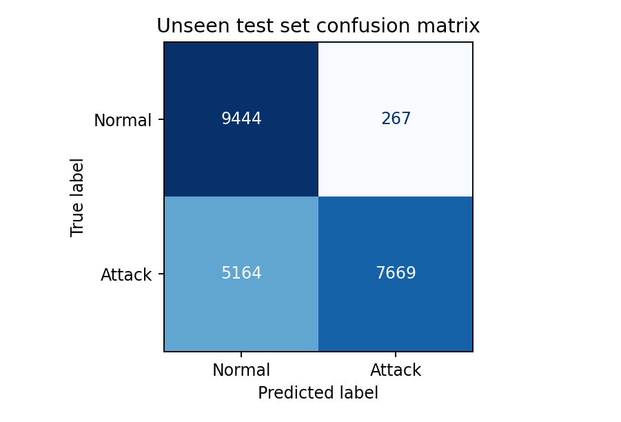

# Network Intrusion Detection

A Random Forest classifier for detecting malicious network connections in the NSL-KDD dataset. The project includes a complete training notebook, evaluation charts, a command-line traffic replay, and a local dashboard.

## Results

Evaluated on the supplied NSL-KDD test set of 22,544 connections. Training uses the published 20% subset, with 25,074 records remaining after duplicate and train/test feature-overlap removal.

| Metric | Result |
|---|---:|
| Accuracy | 75.91% |
| Attack precision | 96.64% |
| Attack recall | 59.76% |
| Attack F1 score | 73.85% |
| False alarms | 267 |
| Missed attacks | 5,164 |



The model detects some attack types well but misses 40.24% of test attacks. It is an experimental detector, not a replacement for a production IDS.

## Getting started

Use Python 3.11 or 3.12. Extract the ZIP and open a terminal in the project folder.

```bash
python -m venv .venv
```

Activate the environment:

```powershell
# Windows PowerShell
.venv\Scripts\Activate.ps1
```

```bash
# Linux or macOS
source .venv/bin/activate
```

Install dependencies and verify the included dataset:

```bash
python -m pip install -r requirements.txt
python src/download_data.py
```

The downloader verifies files using SHA-256 checksums. Dataset sources and feature definitions are documented in [data/README.md](data/README.md).

### Notebook

```bash
jupyter lab IDS_Solution.ipynb
```

Open the notebook from the project root and select **Restart Kernel and Run All Cells**. It covers data exploration, preprocessing, training, evaluation, and record-by-record prediction.

### Scripts and dashboard

```bash
python src/train.py
python src/replay.py --delay 0.3
python src/dashboard.py
```

Open [localhost:8000](http://127.0.0.1:8000) to view results and predict recorded connections. Press Ctrl+C to stop the dashboard.

## Method

- Binary labels: normal = 0, attack = 1.
- Training-only median/mode imputation, one-hot encoding, and standard scaling.
- Random Forest: 100 trees, maximum depth 20, minimum leaf size 2, balanced class weights, seed 42.
- Attack labels and difficulty values excluded from model inputs.
- Preprocessing and classifier saved together in one pipeline.

## Project files

| Path | Contents |
|---|---|
| `IDS_Solution.ipynb` | Complete notebook with executed outputs |
| `src/` | Dataset download, training, replay, and dashboard scripts |
| `data/` | Dataset instructions, checksums, and sample features |
| `results/` | Metrics, classification report, data audit, and attack-type recall |
| `images/` | Data exploration and evaluation charts |
| `models/` | Feature schema and trained prediction pipeline |
| `report/` | Project report |

## Limitations

NSL-KDD is a historical benchmark and does not represent all modern traffic. The supplied test set includes repeated feature records, and detection is weak for several attack types. The replay uses precomputed connection features; it does not capture live packets. Live deployment would require a compatible feature collector and further evaluation.

## References

- [UNB NSL-KDD dataset](https://www.unb.ca/cic/datasets/nsl.html)
- Tavallaee et al. (2009), *A Detailed Analysis of the KDD CUP 99 Data Set*. DOI: [10.1109/CISDA.2009.5356528](https://doi.org/10.1109/CISDA.2009.5356528).
- [scikit-learn RandomForestClassifier](https://scikit-learn.org/stable/modules/generated/sklearn.ensemble.RandomForestClassifier.html)
